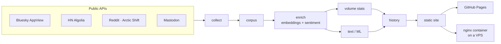

# AI & Robotics — Social-Media Trends

[](https://github.com/ifatwme/ai-robotics-trends/actions/workflows/weekly-update.yml)
[](https://github.com/ifatwme/ai-robotics-trends/actions/workflows/ci.yml)

A weekly, fully automated **statistical + machine-learning analysis of how people talk about AI and robotics** on
Bluesky, Reddit, Hacker News and Mastodon. Every Monday the pipeline collects the last five weeks of public posts,
compares the **latest week with the previous four**, and publishes a static dashboard.

**Live dashboard:** https://ifatwme.github.io/ai-robotics-trends/

## What it measures

| Question | Method |
|---|---|
| Is conversation about X growing or shrinking? | Negative-binomial GLM per daily series (`count ~ current_week + day_of_week`), incidence-rate ratios, Benjamini–Hochberg FDR |
| Did something just happen? | Robust burst detection (median/MAD z-score), change points (binary segmentation) |
| Which brands own the conversation? | Share of voice, χ² homogeneity, Cramér's V, adjusted residuals |
| What are people talking about? | MiniLM sentence embeddings → k-means (k by silhouette) → class-based TF-IDF labels, NMF cross-check, UMAP map |
| Which topics are gaining momentum? | Cochran–Mantel–Haenszel odds ratios stratified by platform |
| What new language appeared? | Weighted log-odds with informative Dirichlet prior (Monroe et al., 2008) |
| How do people feel about it? | Twitter-RoBERTa sentiment (int8-quantised) with VADER agreement check, bootstrap CIs, Mann–Whitney U |
| What gets engagement? | Gradient-boosted classifier of top-decile posts, cross-validated AUC, permutation importance |
| What's next week likely to look like? | Day-of-week NB model + simulation (80% prediction intervals) |

## Architecture



Two containers:

* **`pipeline`** — Python 3.14 batch job (`python -m aitrends <stages>`), non-root, run on demand.
* **`web`** — `nginx-unprivileged`, read-only filesystem, serves `./site`.

## Repository layout

```
.
├── .github/workflows/
│   ├── weekly-update.yml     # Monday cron: build → collect → analyse → commit history → deploy Pages
│   └── ci.yml                # lint, compose validation, image builds + smoke tests
├── src/aitrends/
│   ├── config.py             # paths, rolling window, keyword lists
│   ├── http.py               # polite HTTP client (retries + per-host rate limiting)
│   ├── collect/              # bluesky.py · hackernews.py · reddit.py · mastodon.py
│   ├── corpus.py             # unify, filter, label documents
│   ├── enrich.py             # embeddings + sentiment (id-keyed caches → incremental)
│   ├── analysis/             # volume.py (count statistics) · text.py (topics, sentiment, engagement)
│   ├── history.py            # week-over-week metrics
│   ├── site/build.py         # static dashboard renderer + auto-written findings
│   └── __main__.py           # CLI
├── docker/
│   ├── pipeline.Dockerfile
│   ├── web.Dockerfile
│   └── nginx/                # http.conf · https.conf · security-headers.inc
├── deploy/
│   ├── compose.server.yml    # production override: TLS on 80/443
│   └── systemd/              # weekly pipeline timer + certificate renewal timer
├── scripts/                  # weekly_update.sh · renew_cert.sh
├── history/weekly_metrics.csv  # committed every week by the workflow
├── docs/                     # methodology, project report
├── docker-compose.yml
├── requirements.txt          # pinned
├── Makefile
└── .env.example
```

`data/`, `out/`, `site/`, `cache/` and everything under `deploy/{certs,tls,acme}` are generated and git-ignored.

## Quick start (any machine with Docker)

```bash
git clone https://github.com/ifatwme/ai-robotics-trends.git && cd ai-robotics-trends
make build                 # build both images
make update                # collect the last 5 weeks + analyse + render ./site   (~1–2 h first time)
make up                    # serve it on http://localhost:8080
```

Reproduce a past week: `WINDOW_END=2026-11-09 make update` (exclusive end date, UTC).

Run single stages: `docker compose run --rm pipeline corpus enrich text site`.

## Automation & hosting

| Where | How | Cost |
|---|---|---|
| **GitHub Pages** | `weekly-update.yml` runs every Monday 04:17 UTC (or manually via *Run workflow*), deploys `site/` to Pages | free (public repo) |
| **VPS (optional)** | `deploy/compose.server.yml` + systemd timers: weekly pipeline run, twice-daily Let's Encrypt renewal | your server |

One-time GitHub settings: *Settings → Pages → Source: **GitHub Actions***, and *Settings → Actions → General →
Workflow permissions: **Read and write***.

### Resources per weekly run

Measured on a 4-vCPU / 8 GB VPS; GitHub's `ubuntu-latest` runner for public repos has 4 vCPU / 16 GB.

| Stage | First run (no cache) | Typical weekly run (cache warm) |
|---|---|---|
| Build pipeline image | ~6 min | ~1 min (layer cache) |
| Collect (5 weeks, rate-limited APIs) | 25–40 min | 25–40 min |
| Embeddings + sentiment | ~70 min (~100k posts) | ~10–15 min (~20k new posts) |
| Statistics, topics, ML, site | ~10 min | ~10 min |
| **Total** | **~2 h** | **~45–70 min** |

Peak RAM ≈ 3–4 GB, disk ≈ 5 GB (image 2.7 GB + models 1.1 GB + data). Caches (embeddings, sentiment, models) are kept
in the GitHub Actions cache (≈1.5 GB of the 10 GB per-repo quota). Public repos have unlimited Actions minutes.

### Production server

```bash
cp .env.example .env   # set COMPOSE_FILE, CERT_IDENTIFIER, HISTORY_HOST_DIR
make cert              # first certificate (port 80 must reach the web container)
make up
sudo cp deploy/systemd/* /etc/systemd/system/ && sudo systemctl daemon-reload
sudo systemctl enable --now aitrends-weekly.timer aitrends-cert-renew.timer
```

## Data, ethics & limitations

* Only **public** posts from **keyless public APIs** are used; only aggregates and short excerpts are published.
  The bot identifies itself in its `User-Agent` and rate-limits itself per host.
* Not covered: X/Twitter, TikTok, Instagram, LinkedIn, YouTube (no keyless access).
* Bluesky texts are a *top*-sorted sample; Reddit scores are archived soon after posting (understated engagement);
  Mastodon covers one large instance.
* With ~100k posts, small effects can be statistically significant — the dashboard reports effect sizes alongside
  FDR-adjusted q-values.

See [`docs/methodology.md`](docs/methodology.md) for details.

## License

[MIT](LICENSE)
